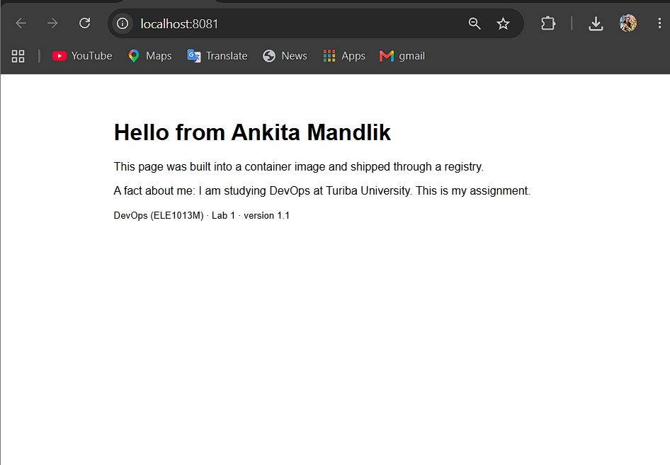

# Lab 1 · Ship it

- **Image:** `ghcr.io/ikaran34/lab1-web:1.0`
- **Digest:** `sha256:0602d07c0d44f470fad738156512a0d3496c7c2bc21629ae2665ca36ebd84ffa`
- **Platforms:** linux/amd64, linux/arm64
- **Partner's image I ran:** `ghcr.io/ankitamandlik5-web/lab1-web:1.0` (digest matched: yes)

## Answers

1. **Where does the kernel used by your containers come from on your laptop?**

   On Windows, containers don't run on the Windows kernel — they run inside a Linux
   VM managed by Docker Desktop, specifically the WSL2 VM. Every container, regardless
   of which Linux distribution its image is based on, shares that one kernel. Proof:
$ docker info --format '{{.OperatingSystem}} | kernel {{.KernelVersion}} | {{.Architecture}}'
Docker Desktop | kernel 6.18.40.1-microsoft-standard-WSL2 | x86_64

$ docker run --rm alpine uname -r
6.18.40.1-microsoft-standard-WSL2

$ docker run --rm ubuntu:24.04 uname -r
6.18.40.1-microsoft-standard-WSL2

Both Alpine and Ubuntu containers report the same kernel version
(`...-microsoft-standard-WSL2`) because they share the host VM's kernel. Their
userland (`/etc/os-release`) differs, but the kernel is common.

2. **What is the difference between `lab1-web:1.0` and `mypage`?**

`lab1-web:1.0` is an **image** — a read-only template that contains the filesystem
(Alpine Linux + nginx + my `index.html`) and the startup command. It never changes
once built.

`mypage` is a **container** — a running instance created from that image. It has
its own writable layer on top of the image's read-only layers. When I edited
`/usr/share/nginx/html/index.html` inside the container, that write went to the
container's writable layer, not to the image. One image can spawn many containers.

3. **In Part 2, the edit to `index.html` survived `docker stop` but not `docker rm`. Why?**

The edit was written into the container's **writable layer**, which sits on top of
the image's read-only layers. `docker stop` stops the process but leaves the
container and its writable layer intact, so `docker start` sees the edit again.
`docker rm` deletes the container **and** its writable layer — the edit is gone.
The image itself is never modified by writes inside a container.

4. **The page is about 1 KB, the image is tens of MB. What is the rest?**

My `index.html` is a single ~500-byte layer. The bulk of the image is the **base
image** `nginx:stable-alpine`, which contains:
- Alpine Linux userland (~5 MB)
- The nginx binary and its shared libraries
- nginx's default config and entrypoint scripts
- The `/usr/share/nginx/html` default page I replaced

That base is ~50 MB compressed and is shared by every container built `FROM` it.
My contribution is just a thin layer on top.
